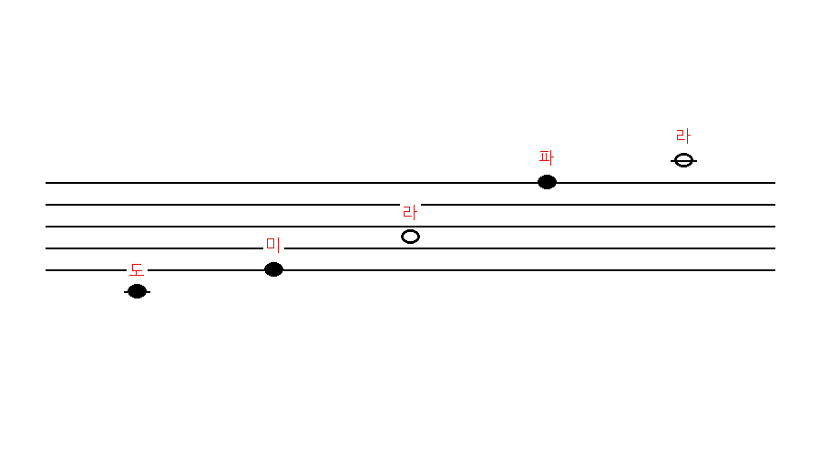

  

<h1 align="center">🎼 악보헬퍼 (Sheet Music Note-Name Helper)</h1>

  악보 이미지를 넣으면 <b>음표를 찾아 계이름(도레미)을 자동으로 붙이는</b> Windows 프로그램입니다. 
  악보를 처음 읽는 사람, 계이름을 일일이 적어가며 연습하는 사람을 위해 만들었습니다.

  

> 사용법은 아래에서, 현재 검증 결과는 [검증된 조건](#검증된-조건)에서 확인합니다.
> 개발·테스트·빌드 절차는 [개발 안내](docs/DEVELOPMENT.md)에 있습니다.

가장 잘 맞는 입력은 **선명한 인쇄 피아노 악보의 스캔 이미지(300dpi 이하)**입니다. exe에서는 PDF를 필요한 쪽별 PNG/JPG로 저장해 넣어 주세요. 사진은 **사진 모드**를 켜고 정면 촬영한 것만 시도합니다. 휘거나 비스듬한 종이, 흐린 사진, 곡 중간 조바꿈·음자리표 변경, 알토 음자리표는 지원 범위 밖입니다. 머리가 붙은 화음과 빈 음표에는 빠진 음이 있을 수 있습니다. 결과 상단의 **조표와 실제 악보 줄 수**를 먼저 확인하세요.

피아노 음색을 도입한 2026-10-07 베타 `d6cf163`의 [검증 기록](docs/releases/d6cf163/PREFLIGHT.md)이 남아 있습니다. 1차 공개판의 준비 내용은 [공개판 사용 안내](docs/public/release-v1/USER_GUIDE.md)에서 확인할 수 있습니다.

## ✨ 주요 기능

- **음표 자동 검출** — 4분/8분음표는 물론 빔(beam)으로 묶인 음표, 2분/온음표(빈 음표), 화음, 레저선(덧줄) 음표까지 검출
- **음자리표 자동 인식** — 피아노 양손 악보처럼 높은음자리표/낮은음자리표가 섞여 있어도 보표별로 자동 판별
- **조표(Key Signature) 인식** — ♯/♭ 개수를 세어 계이름에 반영 (예: 라장조 → `파#`, `도#`)
- **임시표(Accidental) 인식** — 마디 중간의 ♯/♭/♮를 검출하고, 같은 마디 안 같은 음에는 효력이 유지되며 마디가 바뀌면 초기화되는 규칙까지 적용. 화음에서는 기호의 높이를 보고 어느 음의 임시표인지 가려냅니다
- **고정도 / 이동도 선택** — 고정도(C=도)와 **이동도**(으뜸음=도, 한국 교육과정 기준) 중 선택. 단조는 나란한 장조 기준으로 '라'에서 시작합니다. GUI에서도 조성을 직접 지정하고 단조 여부를 켤 수 있습니다(설정에 저장됨)

- **표기 커스터마이즈** — 계이름/영문(C D E) 표기 선택, 글꼴(내 글꼴 파일 지정 가능)/크기/색상 설정 (설정은 자동 저장)
- **라이트/다크 테마** — 🌙 버튼으로 전환, 다음 실행에도 유지
- **계이름 배치** — 음표·기호·다른 라벨을 피할 자리를 탐색하고, 연속 단음의 방향을 정돈합니다. 밀집 화음에서 글씨가 흩어지거나 멀어지는 구간은 추가 개선 대상입니다
- **입력 형식** — PNG/JPG 등 이미지 지원, 스마트폰 캡처 화면도 OK (PDF는 소스 실행 + PyMuPDF 설치 시 지원)
- **음높이 듣기** — 건반으로 선택한 음을 확인하고, 시작·끝 음을 고른 구간을 반복하거나 0.5~1.5배로 재생합니다. 연습 재생은 음높이 확인용입니다.
- **GUI + CLI** — 클릭 몇 번으로 쓰는 GUI와 자동화용 커맨드라인 모두 제공

이동도에서 조표 밖 음을 읽는 자세한 규칙

### 이동도에서 조표 밖 음(임시표)을 읽는 규칙

1. 그 음의 **실제 높이**가 조의 음계에 있으면 그 자리 이름을 그대로 씁니다.
   예) 사장조에서 F♭은 소리로 E — 음계의 6번째 음이므로 **'라'**.
2. 음계에 없으면 **반음 옆 음계 음의 이름에 #/b**를 붙입니다. 어느 쪽 이름을
   쓸지는 그 음에 걸린 변화의 방향을 따릅니다 — 올린 음이면 아래 자리에 `#`,
   내린 음이면 위 자리에 `b`.
   예) 라장조에서 G♯ → **'파#'**, C♮(조표의 C♯을 취소) → **'시b'**.
3. 겹올림·겹내림처럼 1·2로 정할 수 없는 자리만 음이름 글자를 기준으로 적습니다.

> 실측(쇼팽 녹턴 2곡·바흐 미뉴에트): 이동도 라벨 가운데 #/b가 붙는 것은 7~12%이고,
> 나머지는 도·레·미… 일곱 이름으로 떨어집니다. 라장조 곡(RE:Aoharu 3쪽)은 조표 밖
> 음이 없어 라벨 711개 전부가 변화표 없는 이름입니다.

## 📥 실행 파일 받기

전달받은 빌드 ZIP을 풀고 `악보헬퍼.exe`를 실행합니다. Python 설치는 필요 없습니다(Windows 10/11).
ZIP에는 exe와 `build-info.json`, `먼저 읽어주세요.txt`, `LICENSE`, `THIRD_PARTY_NOTICES.txt`가
들어 있습니다. `build-info.json`에는 빌드 기준 커밋, 검증 결과, exe SHA-256이 기록됩니다.
출처와 해시를 확인할 수 있도록 ZIP의 파일을 함께 보관하세요. 개인 설정인 `settings.json`은 배포하지 않으며,
파일이 없는 첫 실행은 프로그램 내장 기본값으로 시작합니다.

2026-08-29 확인 시 [GitHub Releases](../../releases)에 게시된 릴리스는 없습니다.
현재는 검증된 빌드 ZIP을 전달하는 방식이며, 직접 빌드할 때는 [개발 안내](docs/DEVELOPMENT.md)를 따릅니다.
이 프로그램은 아직 전자서명되지 않아 Windows SmartScreen 경고가 나올 수 있습니다.
전달받은 출처와 `build-info.json`의 SHA-256을 먼저 확인한 뒤, 일치할 때만
`추가 정보 → 실행`을 선택하세요. SmartScreen이나 Defender 자체를 끄지는 마세요.

## 🚀 사용법

### GUI (일반 사용자)

1. `악보헬퍼.exe` 실행 (또는 악보 이미지를 exe 아이콘 위로 드래그 — 바로 자동 변환됩니다)
2. **📂 악보 파일 선택** → **✨ 계이름 달기**
3. 결과는 미리보기로 확인, `output/<원본이름>_계이름.png`로 저장

미리보기에서 확대·비교·수정을 이어갈 수 있습니다.

- **확대와 원본 비교** — 마우스 휠 또는 `Ctrl++` / `Ctrl+-`로 최대 8배까지 확대하고 `Ctrl+0`으로 100%로 돌아갑니다. **원본 보기** 버튼이나 `V`로 현재 배율·스크롤 위치를 유지한 채 원본과 결과를 비교합니다.
- **표기 즉시 바꾸기** — 글꼴·크기·색상, 음표 옆/계이름 줄, 범례, 고정도/이동도/영문 표기를 바꾸면 재인식 없이 결과에 반영됩니다. 이동도의 조성·단조 설정도 반영하며, 잘못된 조성 입력은 이유를 안내합니다. 다른 쪽은 쪽을 열거나 전체 쪽을 저장할 때 동기화합니다. 사진 모드의 범례 생략은 유지됩니다.
- **빠른 라벨 수정** — 수정 창의 도~시 또는 C~B 버튼과 숫자키 `1~7`을 사용합니다. `#` / `b`를 다시 누르면 같은 반음 기호가 해제됩니다. 직접 타이핑도 가능합니다.
- **캡처 붙여넣기** — `Win+Shift+S`로 캡처한 이미지가 클립보드에 있으면 `Ctrl+V`로 바로 넣어 변환할 수 있습니다.
- **선택 음 확인** — 라벨을 고르면 하단 건반과 상태 줄에 표시 글씨와 실제 재생 음이름·MIDI 번호를 보여 줍니다. 수정 창의 **이 음만 듣기** 또는 `Ctrl+L`로 그 음 하나를 짧게 들어 봅니다. 건반 범위 밖의 유효 음은 상태 줄로 알립니다.
- **소리와 강조 맞추기** — 하단 싱크 조절로 강조 지연을 0~600ms 범위에서 10ms씩 바꿉니다. 기본값은 220ms이며 다음 실행에도 저장됩니다. 스피커·Bluetooth 장치에서는 직접 들어 보며 맞춰 주세요.
- **여러 쪽 내보내기** — 여러 이미지를 선택해 변환하면 쪽별 PNG와 합본 PDF를 만듭니다. 스타일·표기 변경 후 **현재 표기로 전체 쪽 저장 / PDF**를 누르면 방문하지 않은 쪽까지 반영한 PNG와 300dpi 합본 PDF를 새 폴더에 저장합니다. `PageUp` / `PageDown`으로 쪽을 넘길 수 있습니다.
- **저장과 다시 열기** — 첫 저장 때 출력 폴더를 자동으로 만듭니다. 표기 변경 후 미리보기 저장 안내가 보이면 **다른 이름으로 저장**을 눌러 이미지를 남겨 주세요. 편집을 이어갈 때는 수정본 폴더와 원본 파일을 함께 보관합니다.

음높이 듣기는 음을 일정한 길이로 확인하는 기능입니다. 음표의 실제 길이·쉼표를 인식해 곡을 박자대로 연주하는 기능과 Bluetooth 장치별 검증은 후속 과제입니다. 배포 EXE에는 PDF 직접 입력이 포함되지 않으며, PDF에서 쪽별 이미지로 저장해 넣어 주세요.

왼쪽 설정은 exe 옆 `settings.json`에 저장되어 다음 실행에도 그대로 열립니다:

- **표기 방식** — 계이름(고정도) / 계이름(이동도) / 영문(C D E)
- **조성** — 이동도일 때만 씁니다. 비워 두면 조표를 보고 장조로 읽고,
  단조로 읽으려면 으뜸음(`D`, `Bb`, `F#` 형식)을 적고 **단조**를 켭니다
- 글꼴·글자 크기·색상, 라이트/다크 테마
- **사진 모드** — 정면 촬영한 사진에만 켭니다. 안전하게 보정할 수 없으면 처리를 멈추고 다시 촬영하라고 안내합니다
- **조성 입력** — `D`, `Bb`, `F#`처럼 대문자로 입력합니다(`B♭`, `F♯`도 가능). 잘못된 입력은 예시와 함께 거부합니다. 소문자를 조용히 대문자로 바꾸지 않습니다

결과의 글씨를 눌러 **수정·삭제**할 수 있고, 빈 자리를 누르면 보표·음고·계이름을 직접 지정해 **추가**할 수 있습니다. 여러 번 되돌리기도 가능합니다. 수정본은 새 폴더에 PNG·라벨 목록·사용자 수정 기록으로 저장하고 원본을 덮어쓰지 않습니다. 사람이 고친 글씨는 주황 점선 없이 진하게 표시합니다. 여러 이미지를 처리하면 「이전 쪽·다음 쪽」으로 넘겨 보고 있는 쪽을 수정합니다. 「수정본 폴더 다시 열기...」로 새 형식 수정본을 열어 수정·되돌리기를 이어갈 수 있습니다. 저장 당시 원본 파일도 필요하며, 원본이 없거나 달라지면 열지 않고 이유를 안내합니다. 재열기 정보가 없는 이전 수정본과 새 인식 결과로 수정 내용을 옮기는 기능은 지원하지 않습니다.

최신 소스의 미리보기에서 **다음 확인 필요 ▶ / ◀ 이전**을 누르면 현재 쪽의 연한 글씨·주황 점선을 하나씩 찾아 강조합니다. 키보드 **N = 다음, P = 이전**도 쓸 수 있습니다. 입력칸에 포커스가 있으면 단축키가 동작하지 않으며, 대상이 0개이면 **확인 필요 없음**과 회색 버튼을 표시합니다. 가운데 숫자는 현재 위치와 전체 개수입니다. 라벨 수정 창을 열면 같은 라벨이 선택되며, 사람이 고친 라벨은 순회 대상에서 빠집니다. 쪽을 넘기면 새 쪽에서 다시 시작합니다. 이 이동은 저장된 결과를 바꾸지 않습니다. 단축키 도움말은 F1 또는 ?로 엽니다. 글을 입력하는 칸에서 ?는 그대로 입력되며, 그때도 F1으로 도움말을 볼 수 있습니다.

야간 베타에서 **드래그로 영역 선택**을 켜고 드래그하면 그 안의 음만 별도 결과에 저장합니다. **전체 라벨 다시 보기**로 원래 결과에 복귀합니다. **음높이 듣기**는 선택 구간(없으면 전체)을 Windows 기본 피아노 음색으로 박자 없이 재생합니다. 같은 가로 위치의 음은 함께 울리며, 확인 필요 음 제외 옵션과 듣기 중지 버튼이 있습니다. 피아노 두 보표씩 읽고 박자·음 길이는 인식하지 않습니다.

악보 줄 중간에서 음자리표가 바뀌면 그 뒤 계이름에 **확인 필요** 표시가 붙습니다. 계이름을 자동으로 고치지는 않으며 사진 모드에서는 이 표시를 지원하지 않습니다.

이상이 있으면 **문제 신고용 저장**으로 ZIP을 만들고 틀린 위치와 함께 보내 주세요. [질문 양식](docs/FEEDBACK_FORM.md)에 글씨 크기·Windows 경고·백신 차단 여부도 적을 수 있습니다.

> 소스에서 실행: `python gui.py` (이쪽은 PyMuPDF를 설치하면 PDF도 열립니다)

### CLI와 소스 실행

소스 실행·개발 환경 설치와 전체 옵션은 [개발 안내](docs/DEVELOPMENT.md#cli-사용법)를 참조하세요.
일반 사용자는 위의 GUI 사용법만 따르면 됩니다.

계이름 표시는 인식 확신도에 따라 달라집니다. **보통 글자**는 확실, **조금 옅은
글자**는 주의, **주황 점선 상자**가 있는 글자는 원본 악보와 대조할 필요가 있다는
뜻입니다. 색만으로 구분하지 않도록 확인 필요 항목에는 상자 모양도 함께 표시합니다.

## ⚠️ 어디까지 되는가

### 검증된 조건

아래 표는 **2026-08-28부터 기록한 기존 세 악보의 측정 이력**이며,
새로 처리한 악보 전체의 정확도를 뜻하지 않습니다. 작업 로그와 결정 기록의 숫자는 당시 측정 이력입니다.
추가 공개 악보의 당시 관찰은 [관찰 보고서](docs/UNSEEN_SCORES.md)에 있습니다. 최신 CLI 측정은 [STATUS의 측정 현황](docs/STATUS.md#측정-현황-2026-10-03)과 [OMISSION_RATE](docs/OMISSION_RATE.md)를 참고하세요. 거기에도 미병합 A-25 사본의 결과가 별도로 있으므로 배포판 결과와 구분해야 합니다.

**검증 수준이 악보마다 다릅니다.** 아래 표의 숫자는 서로 다른 것을 센 값이니
그대로 비교하면 안 됩니다.

| 악보 | 조건 | 검증 방법 | 오류율 (당시) | 유령 제거 전 | 오삭제 (음표 기준, 2026-09-22) |
|---|---|---|---|---|---|
| RE:Aoharu 3쪽 (라벨 711) | ♯2 라장조, 4/4, PNG 1640×2360 (스마트폰 캡처) | **전수** — 원본과 한 마디씩 대조 | **0%** | 0% | **1쪽 0%** (음표 226개 중 0) |
| 바흐 미뉴에트 가단조 (191→185) | 조표 없음, PDF 300dpi | **전수** — 라벨 하나씩 확대 | **4.4%** (8개) | 7.3% | **0%** (173개 중 0) |
| 쇼팽 녹턴 D♭장조 **1쪽** (320→240) | ♭5, 6/8, 32분음표, PDF 2481×3508 | **전수** — 라벨 하나씩 확대 | **2.1%** (5개) | 26.6% | **10.0%** (239개 중 24, 전부 붙은 화음) |
| 쇼팽 녹턴 D♭장조 **2~6쪽** | 위와 같음 | **표본 300개** (쪽당 50, 5쪽은 100, 시드 고정) | **3.3%** | 6.7% | 미측정 |

> **「오류율」 열은 라벨 쪽에서 센 값이라 빠진 음(오삭제)이 안 들어 있습니다.** 오삭제는 2026-09-22에
> 정답 음표부터 세어 따로 쟀습니다(`docs/OMISSION_RATE.md`). 쪽마다 크게 달라 **합계를 일반 비율로 쓰지 않습니다.**
> 쇼팽 녹턴 B♭단조 1쪽도 같은 방법으로 쟀고 오삭제 0%(270개 중 0)입니다 — 단 임시표 수정(PR #62)을 반영한
> 값이고, 반영 전에는 임시표 옆 음표 9개가 빠집니다.

> **전수 판정한 쪽과 표본 판정한 쪽을 구분해 적었습니다.** 한동안 쇼팽의 오류율을
> 1쪽 하나로 말했는데, 그건 **낙관적인 값**이었습니다 — 2~6쪽을 표본으로 재 보니
> 1쪽보다 두 배 높았습니다(3.8% vs 6.7%, 당시 기준). 지금은 그 격차의 주원인이던
> `beam_mask` 결함을 고쳐 1쪽 2.1% / 2~6쪽 3.3%로 좁혀졌습니다.
>
> 판정 기준은 사람이 라벨 자리를 확대해 '음표 머리가 있는가'를 본 것입니다.
> **지우는 쪽은 표본이 아니라 전 쪽에서 확인했습니다** — 필터가 지우는 것을 쇼팽 6쪽
> 전부와 바흐·RE:Aoharu에서 뽑아 하나씩 확대해 봤고, 지운 것 중 음표는 없었습니다.

**기존 세 악보에서 확인한 오류의 내역** — 세어 보니 **전부 유령**(라벨은 있는데
그 자리에 음표가 없는 것)이었습니다.

> **음고 오표기 — 단순한 악보에서는 0이지만, 머리가 붙은 화음이 많은 악보에서는 생깁니다.**
> 예전에 「811개 중 0개」라고 적었는데, 그건 **라벨 쪽에서 센 값**이라 붙은 화음에서 두 머리 사이에
> 붙은 라벨을 놓쳤습니다. 2026-09-22에 정답 음표부터 다시 세니 RE:Aoharu 1쪽 · 바흐 · 쇼팽 B♭단조 1쪽은
> 0이었고, **쇼팽 D♭장조 1쪽은 239개 중 10개(4.2%)**가 옆 음으로 읽혔습니다(전부 붙은 화음).
> 음이름·옥타브만 대조한 값입니다(`docs/OMISSION_RATE.md`). 3단 이상 악보나 곡 중간 조바꿈도 검증 범위 밖입니다. 새 공개 악보에서는 쇼팽 빗방울 24마디 F5를 `파#`(정답 `파`)로,
> 오르간 A♭4를 `도`로 표기한 사례가 확인됐습니다.

| 유형 | 쇼팽 1쪽 | 바흐 |
|---|---|---|
| 빔에 얹히거나 끼어 있는 자리 | 79 | 10 |
| 음표가 아닌 것 — 셈여림 `p`, 페달 `Ped.`, 템포 `♩.=50`, 트릴 `tr` (해결됨) | 6 | 2 |
| 음표가 아닌 것 — 박자표 숫자 (해결됨) | 0 | 2 |
| 음고 오표기 (라벨 쪽 판정 — 붙은 화음 오류를 못 봄. 음표 쪽 재측정은 위 인용 참고) | 0 | 0 |
| 판정 애매 | 4 | 3 |

> 한 가지 단서: 오래 쓰던 `--verify`(좌우 잉크 검사)는 유령의 **일부만** 셉니다.
> 빔 위에 앉은 유령은 잉크가 꽉 차 있어 그 검사를 통과합니다. 쇼팽에서 그 검사가
> 센 값은 102개였지만 실제로는 85개가 1쪽에만 있었습니다.

개발 참고: 기존 판정 조건과 과거 검증 사례

2026-08-29 문서 정리 전부터 기록된 사례입니다. 새 악보 검증 결과가 아닙니다.

### 판정 조건을 채택하는 규칙

이 프로젝트에서 같은 조건이 악보에 따라 정반대로 동작한 적이 있습니다 —
'오선 밖인데 덧줄이 없다'는 조건의 정밀도가 쇼팽에서 82.8%, 바흐에서 10.3%였습니다.
한 악보에서 잰 값을 그대로 믿었다면 바흐에서 진짜 음표 19개를 지웠을 것입니다.
(원인은 조건이 아니라 덧줄 검출 쪽 결함이었습니다. 덧줄 검출을 고쳐 두 악보의
**1쪽에서는** 정밀도가 100%까지 올라갔지만, 쇼팽 5쪽에서 다시 무너졌습니다 —
아래 「같은 악보의 다른 쪽도 다른 악보다」를 보십시오.)

- **한 악보에서 잰 정밀도를 다른 악보에 적용하지 않습니다.** 조건이 다른 악보
  최소 두 개에서 재고, **둘 다 높을 때만** 판정에 씁니다. 한쪽만 높으면 참고용으로만
  남깁니다.
- **오삭제 0은 절대 조건입니다.** 유령은 사용자가 "없는 음이 하나 더 있네" 하고
  넘어가지만, 지워진 음은 알아챌 방법이 없습니다.
- 문턱값은 눈대중으로 정하지 않고 실측 분포나 음악 규칙에서 유도하고,
  그 근거를 코드 주석에 남깁니다(어느 악보·어떤 오선 간격에서 잰 값인지 포함).

지금 이 기준을 통과해 **판정에 쓰는 조건은 여섯**입니다.

| 조건 | 음악 규칙 | 실측 |
|---|---|---|
| 빔 위 · 빔 사이 · 빔에 닿음 (빈 음표만) | 빔은 8분음표 이하에만 붙고 그 머리는 채워져 있다 | 정밀도 100%, 오삭제 0 |
| 좌우 잉크 없음 | 음표 머리는 채워졌든 비었든 중심의 좌우 양쪽에 잉크가 있다 | 정밀도 100%, 오삭제 0 |
| 오선 밖인데 덧줄 없음 | 오선 밖의 음은 덧줄 위나 덧줄 사이 칸에 놓인다 | 두 악보 전 쪽 90개 제거, 전부 유령, 오삭제 0 (원리적 한계는 아래) |
| 박자표 자리 | 박자표는 한 시스템의 모든 보표에 같은 x로 정렬된다 | 바흐 2개 제거, 오삭제 0 |

나머지(잔차 큼, 위아래 막힘)는 값만 기록하고 판정에는 쓰지 않습니다.

#### 같은 악보의 다른 쪽도 '다른 악보'다

두 악보 원칙을 지켜도 부족했던 사례가 있습니다. '오선 밖인데 덧줄 없음' 조건을
덧줄 검출을 고친 뒤 다시 재니 **쇼팽 1쪽 9/9, 바흐 1쪽 1/1로 양쪽 다 정밀도 100%,
오삭제 0**이었습니다. 두 악보 원칙을 통과한 것입니다. 그런데 같은 필터를 쇼팽
**6쪽 전체**에 걸어 보니 154개를 지우고 그중 **11개가 진짜 음표**였습니다
(5쪽 x=1262·1742·1794·1833·1872·1911·1950·1989·2028·2197 y≈763~808, x=1815 y=2812).

원인은 조건이 아니라 덧줄 검출이었습니다. 당시 `ledger_ys`는 머리 바깥 좌우 띠에서
각각 잉크 비율 0.4를 요구했는데, 그 자리 덧줄이 왼쪽에서 0.33밖에 못 채웠습니다 —
좌우 띠의 위치가 **머리 중심 추정에 매달려 있어서**, 중심이 몇 px만 치우쳐도
한쪽이 무너집니다. 지금은 머리를 기준으로 좌우를 나누지 않고 **덧줄 y에서 수평 런의
길이**를 잽니다(덧줄은 수평선이고, 머리보다 넓게 그린다). 고친 뒤 두 악보 전 쪽에서
다시 재어 90개 제거·전부 유령·오삭제 0을 확인하고 채택했습니다.

**따라서 검증 단위는 '악보'가 아니라 '쪽'입니다.** 정답셋이 있는 1쪽만 재고 통과라고
말하면 안 됩니다. 지울 후보를 전부 뽑아 눈으로 확인하는 절차를 반드시 거칩니다 —
이번 11개도 정밀도 숫자가 아니라 그 절차로 찾았습니다.

#### '덧줄 없음' 조건이 원리적으로 못 잡는 것

이 조건은 유령 18개를 **일부러 놓아 줍니다.** 필요한 덧줄 자리에서 반칸(±0.45sp)
안에 **이웃 음표의 진짜 덧줄**이 있으면 '덧줄이 있다'로 인정하기 때문입니다.
그 허용 오차는 좁힐 수 없습니다 — 실측하면 두 분포가 겹칩니다:

| | 표본 | \|필요 y − 실제 덧줄 y\| |
|---|---|---|
| 정상 음표 (허용해야 하는 값) | 130 | 중앙 0.18 / **최대 0.30sp** |
| 놓아 준 유령 (막아야 하는 값) | 18 | **최소 0.12sp** / 중앙 0.84 |

0.12~0.30sp에서 겹치므로, 좁히면 유령 몇 개를 더 잡는 대신 오삭제가 납니다.
겹치는 구간을 포기하고 넉넉한 쪽을 택했습니다.

놓아 준 18개는 대부분 임시표(♯♭♮)인데, **임시표는 자기가 붙는 음표와 같은 높이에
놓이므로 그 음표의 덧줄과 세로로 겹치는 것이 조판 규칙상 당연합니다.**
이 조건으로는 구분할 수 없습니다 — 부작용이 아니라 원리적 한계입니다.
18개 중 7개는 임시표 유령 제거 단계에서 어차피 사라지고, 최종 라벨로 남는 것은
11개입니다(쇼팽 1쪽 1개, 2~6쪽 10개, 바흐 0개).

**잘 되는 조건**

- 인쇄 악보 또는 악보 프로그램이 렌더링한 이미지 (PDF는 300dpi 기준)
- 오선 간격(spacing) 11px 이상 — 위 검증에서 11.2~19.2px
- 피아노 대보표(높은음/낮은음자리표 두 줄)와 단일 보표 모두
- ♯·♭ 조표 0~5개, 마디 중간 임시표(♯/♭/♮)와 마디 안 지속 규칙

### 안 되는 조건

먼저 사용자가 실제로 보게 되는 증상으로 정리하면 다음과 같습니다.

| 입력·조건 | 사용자에게 보이는 증상 |
|---|---|
| 악보가 없는 PDF 표지·빈 페이지 | 계이름 결과가 나오지 않고 오선 검출 오류로 끝날 수 있습니다. |
| 일부 PDF를 600dpi로 처리 | 같은 PDF가 300dpi에서는 되더라도 600dpi에서는 결과 없이 오류로 끝날 수 있습니다. |
| 흐리거나 기울어진 오래된 스캔 | 완료 메시지가 나와도 악보의 일부에만 계이름이 표시될 수 있습니다. |
| 곡 중간 조바꿈 | 조가 바뀐 뒤 계이름의 `#`·`b`가 틀릴 수 있습니다. |
| 보표 중간 음자리표 변경 | 바뀐 자리 뒤의 음을 다른 높이로 읽고, 음자리표에 계이름이 붙을 수도 있습니다. |
| 알토 음자리표 | 지원하지 않습니다. 그 줄 계이름은 틀릴 수 있고 「확인 필요」 표시가 붙습니다. |
| 줄이 짧은 마지막 단 | 마지막 단 전체에 계이름이 표시되지 않을 수 있습니다. |
| 반복선 뒤 조표 | 조표 기호 자체에 계이름이 붙을 수 있습니다. |
| 3단 이상 큰보표 | 일부 보표에 잘못된 음자리표·조표가 적용되어 계이름이 틀릴 수 있습니다. |
| 같은 악보의 해상도 변경 | 이미지 크기만 바꿔도 표시되는 계이름의 수와 위치가 달라질 수 있습니다. |
| 손글씨·기울어진 사진·접힌 종이 사진 | 오선을 찾지 못하거나 악보 일부만 처리할 수 있습니다. |
| 음표가 촘촘히 붙은 화음 | 일부 음표에 계이름이 빠지거나 옆 음으로 표시될 수 있습니다. |
| 빈 음표(2분·온음표)가 다른 음표와 세로로 가까이 붙은 자리 | 빈 음표나 3도 빈 화음의 윗머리가 계이름 없이 사라질 수 있습니다(가림 규칙). |

- 악보 없는 PDF 표지·빈 페이지 — 오선을 찾지 못해 처리가 끝날 수 있습니다. 악보가 있는 페이지를 선택하세요.
- 일부 PDF의 600dpi 처리 — 바흐 미뉴에트 첫 쪽에서 `StaffNotFoundError`가 재현됐습니다.
  같은 입력은 300dpi에서 전처리가 됐으며, 모든 600dpi PDF가 실패한다는 뜻은 아닙니다.
  [실패 입력과 재현 조건](docs/INPUT_FAILURES.md)을 참고하세요.

- 손글씨 악보, 기울어진 사진, 접힌 종이를 찍은 사진
- **곡 중간 조바꿈은 미지원** — 조표를 페이지에 한 번만 판정하는 구조입니다.
  쇼팽 빗방울 전주곡 24마디 F5를 `파#`(정답 `파`)로 표기한 실제 계이름 오류가
  확인됐습니다. 이동도도 페이지의 첫 조표 하나를 기준으로 계산합니다.
- **헤더 밖 조표·음자리표** — 반복선 뒤 조표와 곡 중간 음자리표를 악보 기호로
  제외하지 못하고 음표처럼 라벨링할 수 있습니다. Beethoven WoO 78에서 조표
  3플랫 2벌과 중간 높은음자리표에 라벨이 붙는 사례가 확인됐습니다.
- **3단 이상 큰보표는 미검증** — 오르간 3단 악보에서 음자리표 12개 중 2개를
  잘못 읽었고, 실제 4플랫 조표를 0개로 판정했습니다.
- **오래된 스캔** — 오선 간격이 충분해도 흐린 명암과 기울기 때문에 검출에 실패할 수
  있습니다. 아래 「조용한 부분 성공」의 사티 사례를 확인하세요.
- **해상도 변경** — 같은 RE:Aoharu 입력을 0.5배/원본/1.5배로 바꾸자 라벨 수가
  111/226/233개로 달라졌습니다. 해상도를 바꾼 결과의 정확도는 검증하지 않았습니다.
- 겹올림·겹내림(𝄪, 𝄫), 꾸밈음, 타브 악보
- 음표의 길이(리듬) — 분석하지 않습니다. 계이름 표기가 목적입니다

성악 가사가 있는 공개 악보 한 쪽에서는 가사에 라벨이 붙지 않고 9보표가 처리됐지만,
음고 정확도까지 판정한 것은 아니므로 아직 검증된 조건으로 분류하지 않습니다.

### 조용한 부분 성공

오선 검출이 일부만 성공해도 오류 없이 완료될 수 있습니다. 처리 로그의 **검출된
보표 수가 원본 악보의 실제 보표 수와 맞는지 확인하십시오.** 소스 실행 결과에서는
`output/1_staff_debug.png`의 빨간 오선과 초록 보표 상자로도 확인할 수 있습니다.

사티 《Ogive III》의 오래된 스캔은 3654×4436, 400dpi이고 오선 간격도 약 20px라
위의 11px 조건을 만족했지만, 실제 8보표 중 1보표만 검출한 뒤 44개 라벨을 만들고
정상 완료했습니다. 완료 메시지만으로 악보 전체가 처리됐다고 판단하면 안 됩니다.
재현 조건과 좌표는 [새 악보 관찰 보고서](docs/UNSEEN_SCORES.md)와
[실패·부분 처리 목록](docs/INPUT_FAILURES.md)에 있습니다.

현재 미완료 작업과 담당자는 [TASKS](docs/TASKS.md)에서 관리합니다.
아래 상세 표는 기존 실측과 증상을 보존한 기록이며, 작업 우선순위 목록이 아닙니다.

기록된 증상과 실측 상세

### 기록된 증상과 실측

2026-08-29 정리 전부터 있던 측정·증상 기록입니다. 당시 값과 설명을 보존하며, 현재 오류율은 위 검증 표를 기준으로 봅니다.

| 항목 | 실측 | 상태 |
|---|---|---|
| 빔 사이 틈을 빈 음표로 오검출 | 쇼팽 D♭ 1쪽 기준 79개(라벨의 24.7%) | **대부분 해결** — 빔에 닿은 빈 음표를 버립니다(정밀도 100%, 오삭제 0). 세 악보에서 416개 제거. 쇼팽 1쪽의 남은 유령은 5개, 2~6쪽 표본 오류율은 3.3% |
| ~~음표가 아닌 글리프를 음표로 검출~~ | 셈여림 `p`·`pp`·`f`, 페달 `Ped.`, 템포 `♩.=50`, 나타냄말 `cresc.`·`dim.`, 손가락 번호, 악센트 `>`, 트릴, 임시표 글리프 | **해결.** '오선 밖인데 덧줄 없음'으로 버립니다. 쇼팽 6쪽 89개 + 바흐 1개 제거, **전부 확대해 확인한 결과 음표는 하나도 없었습니다**(오삭제 0) |
| ~~박자표 숫자를 음표로 검출~~ | 바흐 1쪽에서 3/4의 숫자 두 개 | **해결.** 박자표는 한 시스템의 모든 보표에 같은 x에 세로로 맞춰 그린다는 규칙을 씁니다 — 위 보표는 음자리표 꼬리가 먼저 '숫자 폭' 조건을 만족해 탐색이 일찍 멈췄고, 아래 보표가 찾은 끝값을 그대로 씁니다. 바흐 2개 제거·오삭제 0, 쇼팽·RE:Aoharu 변화 없음 |
| **음고 오표기** (음표는 있는데 다른 음으로 읽음) | 음표 쪽에서 센 값: RE:Aoharu 1쪽 · 바흐 · 쇼팽 B♭m 1쪽 **0**, 쇼팽 D♭ 1쪽 **10개(4.2%)** — 전부 붙은 화음. 조바꿈·3단 악보에서도 오표기 확인 | 붙은 화음은 고치지 않는다(알려진 한계). 예전 「811개 중 0개」는 라벨 쪽 판정이라 철회 |
| ~~덧줄 검출 실패~~ | 고치기 전: 바흐 1쪽 19개(폭 임계값 시절), 쇼팽 5쪽 11개(좌우 띠 시절) | **해결.** 덧줄은 수평선이므로 머리 기준 좌우 띠가 아니라 **덧줄 y에서 수평 런의 길이**를 잽니다. 문턱 1.30sp는 실측에서 유도했습니다 — 머리 폭은 두 악보 모두 봉우리가 1.2sp, 덧줄 있는 정상 음표의 런은 최소 1.40sp, 덧줄 없는 유령은 최대 1.19sp. 필요한 덧줄 수도 `int(dist/sp + 0.25)`에서 **내림**으로 고쳤습니다(전자는 머리 y가 0.4sp 치우치면 없는 덧줄을 하나 더 요구합니다) |
| 빔이 오선만큼 길면 보표를 통째로 놓침 | 쇼팽 D♭ 5쪽에서 보표 1개(대보표 한 짝의 낮은음자리표) 누락 | 미해결. 오선 5줄 + 빔 2줄이 7줄 그룹이 되어 폐기됩니다 |
| 화음 상하 역전 | 라장조 3쪽 0쌍 / 쇼팽 D♭ 6쪽 10쌍 | 값은 맞고 위아래 순서만 바뀝니다 |
| 라벨이 음표에서 30px 초과 | 라장조 3쪽 5개(0.7%) / 쇼팽 D♭ 57개(2.5%) | 두 보표 사이가 좁아 자리가 없는 경우 |
| 라벨이 오선 위에 얹힘 | 라장조 3쪽 28% / 쇼팽 D♭ 51% | 흰 테두리가 있어 읽는 데 지장 없습니다. 음표 밀도가 높을수록 늘어납니다 |
| 마디 번호가 실제와 어긋남 | 라장조 1쪽에서 2마디 적게 셈 (놓친 마디선 x=459, 두 곳) | **라벨에는 영향 없습니다.** 마디 번호를 세는 `verify.barline_positions`와 임시표 유효범위를 초기화하는 `accidental_detect._find_barlines`는 별개 함수이고, 놓친 것은 앞쪽입니다. 원인은 마디선 9px 옆에 음표가 있어 기둥으로 보고 건너뛴 것 |
| 임시표 글리프가 음표로 잡히는 유령 | 쇼팽 D♭ 6쪽에서 12개 남음(라벨의 0.5%) | 임시표가 음표에서 2sp 넘게 떨어져 있거나, 그 임시표의 주인 음표를 못 찾은 경우입니다. **오선 밖**에 있는 것은 덧줄 필터가 잡습니다 — 남은 것은 오선 안에 있는 경우입니다 |
| 단조 자동 판별 | 없음 | 조표만으로는 장조와 나란한 단조를 구별할 수 없습니다. 이동도 자리표는 어느 쪽이든 같으므로 대개 그대로 맞고, 다르게 읽고 싶으면 `--key D --minor`(GUI에서는 조성 칸 + 단조 체크)로 지정합니다 |

오류율 수치의 과거 기록 (FIXED에서 모은 값)

2026-08-29 정리 기준, 기존 FIXED에 있던 수치를 한곳에 보존했습니다. 새 측정값이나 현재 전체 정확도가 아닙니다.

| 과거 기록 | 당시 수치 |
|---|---|
| 빔 사이 틈 오검출, 쇼팽 D♭ 1쪽 | 라벨의 24.7% (79개) |
| 좌우 잉크 검사로 센 유령과 육안 판정 차이 | 4.5% / 26.6% |
| 좌우 띠 방식의 1쪽 한정 정밀도 | 100% (이후 다른 쪽에서 정상 음표 손실 발견, 기각됨) |
| 남은 유령 표본 중 빔 관련 유형 비중 | 65% |
| 라벨끼리 겹침의 과거 측정 | 18% |

### 계이름 표기 규칙 요약

- **고정도**(기본): C=도 고정. 조표가 적용되는 음에는 #/b가 붙습니다(라장조 F → `파#`).
- **이동도**: 으뜸음이 도. 조표 밖 음은 [위의 규칙](#이동도에서-조표-밖-음임시표을-읽는-규칙)대로
  가장 가까운 음계 도수에 #/b를 붙입니다.
- 단조는 나란한 장조 기준으로 '라'에서 시작합니다(한국 음악과 교육과정).

## 문서 안내

| 문서 | 담는 내용 |
|---|---|
| README | 사용자 사용법, 지원 범위, 현재 오류율의 기준 표 |
| [DEVELOPMENT](docs/DEVELOPMENT.md) | 개발 환경, 테스트와 빌드 절차, 동작 원리 |
| [WORKLOG](WORKLOG.md) | 날짜별 작업·검증·인계 이력. 기존 기록을 보존하고 추가만 함 |
| [TASKS](docs/TASKS.md) | 아직 끝나지 않은 작업, 담당자, 완료 조건 |
| [DECISIONS](docs/DECISIONS.md) | 판정 조건의 채택·기각 근거와 측정 이력 |
| [FIXED](docs/FIXED.md) | 고친 버그의 증상·원인·발견 경로 |
| [PORTABILITY](docs/PORTABILITY.md#앱-이행-시-확인할-것) | 앱 이행 시 확인할 것과 기존 측정 이력 (추가 조사 보류) |
| [UNSEEN_SCORES](docs/UNSEEN_SCORES.md) | 새 공개 악보의 결과·관찰 좌표·출처 (정답 판정 전) |
| [INPUT_FAILURES](docs/INPUT_FAILURES.md) | 입력 실패·부분 처리와 재현 조건 |
| [GHOST_CASES](docs/GHOST_CASES.md) | 확인된 유령 유형과 악보별 실측 좌표 |

## 📄 라이선스

[MIT License](LICENSE)

### 서드파티 라이선스

| 라이브러리 | 라이선스 | 비고 |
|---|---|---|
| OpenCV (opencv-python) | Apache-2.0 | |
| NumPy / SciPy | BSD-3-Clause | |
| Pillow | MIT-CMU | |
| customtkinter | MIT | |
| PyInstaller | GPL-2.0 (부트로더 예외) | 빌드된 프로그램에는 라이선스 전파 없음 |
| PyMuPDF | **AGPL-3.0** | 선택 설치. 배포용 exe에는 포함하지 않음 |

코드의 MIT 라이선스와 검증용 악보의 권리는 별개입니다. `sample_images/`·`test_scores/`에는 상업 악보가 포함되어 있으므로 외부에 공개하거나 저장소를 public으로 바꾸지 마세요. [협업 규약](docs/COLLAB.md#6-검증용-악보)을 따릅니다.
