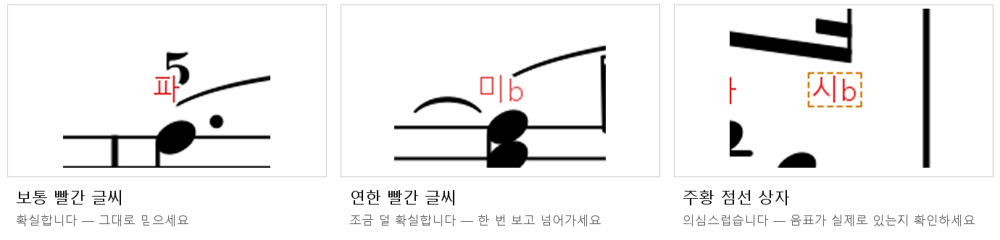

# 악보헬퍼 — 지금 사용할 수 있는 범위

악보 이미지에 계이름(도·레·미)을 붙여 주는 프로그램입니다.
**계이름이 틀리거나 빠질 수 있으므로 원본과 함께 확인해 주세요.**

2026-10-07 이전 베타 후보는 `d6cf163`입니다. 음높이 듣기를 피아노 음색으로 바꾸고, 이전 음고 중심·기호 유령·GUI/신고 보호를 유지합니다. [빌드·실제 exe·Defender·Windows 검증 기록](releases/d6cf163/PREFLIGHT.md)을 확인하세요. 이 exe의 직접 클릭·스피커 청취·다운로드 SmartScreen은 미확인입니다. 예전 PNG/수정본은 자동으로 고쳐지지 않으므로 새 exe에서 원본을 다시 변환하세요.

2026-10-12 현재 친구 배포는 보류하고 우리끼리 검증합니다. CLI 신호를 확인한 뒤 새1ad8323 exe를 빌드해 다쪽 진행 표시·확인 필요/주의 순회·N/P·p/겹빔 check 표시까지 검증했습니다. 이전 d6cf163 exe에는 이 변경이 없습니다.

## 잘 되는 것

- 선명한 인쇄 피아노 악보: 오른손·왼손 두 줄이 한 쌍인 악보
- 곡 처음부터 끝까지 조표가 같은 악보
- ♯이 1~7개인 조표, ♭이 1~7개인 조표, 조표가 없는 악보

배포 프로그램은 PNG/JPG 이미지를 사용합니다.
PDF라면 사용할 쪽을 먼저 PNG/JPG로 저장해 주세요.

## 안 되는 것

| 악보 | 나타날 수 있는 문제 |
|---|---|
| 사진 촬영본 | 살짝만 기울어도 조표를 다르게 읽거나 악보 줄을 놓칩니다 |
| 곡 중간에 조가 바뀌는 악보 | 바뀐 뒤부터 계이름이 틀릴 수 있습니다 |
| 세 줄 이상이 한 묶음인 악보(오르간 등) | 여러 줄을 함께 제대로 읽지 못합니다 |
| 오래되거나 흐린 스캔 | 악보 줄이나 음표를 놓칠 수 있습니다 |
| 음표가 촘촘히 붙은 화음 | 계이름이 빠지거나 옆 음으로 표시될 수 있습니다 |
| 보표 중간 음자리표 변경 | 바뀐 뒤 음을 다른 높이로 읽습니다. 야간 베타부터는 바뀐 뒤 계이름에 「확인 필요」 표시가 붙습니다(계이름 자체는 고쳐지지 않습니다) |
| 알토 음자리표 | 지원하지 않습니다. 최신 소스는 알토 줄의 계이름 전체에 「확인 필요」를 붙입니다 |
| 줄이 짧은 마지막 단 | 줄 전체의 계이름이 빠질 수 있습니다 |
| 600dpi 같은 고해상도 스캔 | 야간 베타부터 악보 줄은 찾지만(시험 17쪽 모두), 음 누락은 300dpi만큼 확인하지 않았습니다. 300dpi 이하를 권합니다 |
| 덧줄이 5개 이상인 아주 높은 음 | 최신 소스는 덧줄 사다리 끝까지 찾습니다(시험 악보에서 빠지던 79개 되찾음). 드물게 빠질 수 있습니다 |
| 꾸밈음(작은 음표), 겹올림·겹내림(𝄪 𝄫) | 지원하지 않습니다 |

사진은 정면에서 찍어도 잘 읽힌다고 보장할 수 없습니다.

**사진 모드가 있습니다.** 정면에서 찍은 사진에만 켜세요. 보정이 안전하지 않으면 다시 촬영하라고 안내하고 처리를 멈춥니다. 휘거나 비스듬한 종이와 손에 들고 찍은 사진의 인식은 보장하지 않습니다. 가능하면 스캐너·복사기·거치대로 정면 이미지를 만드세요.

## 결과에서 확인할 것

1. **줄 수:** 화면의 “악보 줄 N개를 찾았습니다”가 실제 줄 수와 맞는지 봅니다.
   다섯 가로선이 모인 것을 한 줄로 셉니다. 피아노 오른손·왼손 한 쌍은 두 줄입니다.
2. **주황 점선:** 없는 음이 표시됐을 수 있으니 여기를 먼저 원본과 비교합니다.
3. **빈 음표:** 2분음표·온음표의 계이름이 드물게 빠질 수 있습니다.
4. **결과 상단 조표:** 실제 조표와 다르면 계이름을 믿지 말고 원본과 비교합니다.
5. **♯·♭·♮ 주변:** 계이름이 빠지거나 잘못 붙지 않았는지 봅니다.

줄 수가 맞고 점선이 없어도 모든 계이름이 맞다는 뜻은 아닙니다.

## 계이름에 붙는 표시

| 모습 | 뜻 |
|---|---|
| 보통 빨간 글씨 | 프로그램이 특별히 의심 표시를 붙이지 않은 자리입니다 |
| 연한 빨간 글씨 | 한 번 더 살펴볼 자리입니다 |
| 주황 점선 상자 | 원본과 먼저 비교할 자리입니다 |

## 시작과 저장

압축을 모두 풀고 `악보헬퍼.exe`를 실행합니다.
이미지를 고른 뒤 “계이름 달기”를 누르면 exe 옆 `output` 폴더에
결과 이미지와 계이름 목록 파일이 생깁니다. 바꾼 설정은 다음 실행에도 유지됩니다.

결과 글씨 클릭으로 수정·삭제, 빈 자리 클릭으로 추가, 여러 번 되돌리기를 지원합니다. 원본을 보존하고 새 폴더에 수정본 PNG·라벨 JSON·사용자 수정 기록을 함께 저장합니다. 사람이 고친 글씨는 진하게 표시합니다. 여러 이미지 결과는 「이전 쪽·다음 쪽」으로 넘기며 보고 있는 쪽을 수정합니다. 「수정본 폴더 다시 열기...」로 새 형식 수정본을 열어 수정·되돌리기를 이어갈 수 있습니다. 저장 당시 원본 파일도 필요하며, 원본이 없거나 달라지면 열지 않고 이유를 안내합니다. 재열기 정보가 없는 이전 수정본은 지원하지 않습니다.

야간 베타는 드래그 영역 선택·별도 결과 저장과 음높이 듣기(박자 없이, 확인 필요 제외 옵션)를 지원합니다. 원본 결과로 되돌릴 수 있고 기본 변환 결과는 그대로입니다. 옥타브 GUI는 배치 판단 대기(PR #167)로 이번 빌드에서 제외합니다. PDFium도 조사만 했으며 exe PDF 지원 도입은 결정하지 않았습니다. 박자·음표 길이 읽기는 지원하지 않습니다.

실행 방법과 Windows 경고 안내는 [먼저 읽어주세요](../먼저%20읽어주세요.txt)를 참고하세요.

## 측정 현황 (2026-10-07, main — 링 벽 B안 §1-29(#263) 반영, 그 앞 §1-24~28 포함)

개발용 기록입니다. 이 날 main 제품으로 **다시 잰** 값입니다(정답이 있는 세트, 라벨 `debug/sim_lp/main1007`).

| 세트 | 정답 머리 | 누락 | 음고 틀림 | 표기 틀림 | 유령 |
|---|---:|---:|---:|---:|---:|
| PDF 17쪽(LilyPond) | 4,725 | **84 (1.8%)** | 38 (0.8%) | 106(실효 정답 — ※) | 330 (7.0%) |
| Aoharu 3쪽(정답 골든) | 711 | 0 | 0 | 0 | 0 |
| Verovio 20쪽(Bravura · Leipzig) | 7,933 | **555 (7.0%)** | 820 (10.3%) | 184 (2.3%) | 479 (6.0%) |
| 보지 않은 악보 8쪽(월광 · 빗방울) | 2,724 | **119 (4.4%)** | 112 (4.1%) | (안 잼) | 208 (7.6%) |
| 사진 합성 51장(사진 모드) | — | 485 | 107 | 85 | 727 — 링 벽 B안은 사진 모드 미적용(라벨 변화 0) |

- ※ PDF 표기는 2026-10-06 정답 도구 수정(E단조 마디선) 뒤 기준 — 그 앞 문서의 120 등과 직접 비교하지 않는다.
- 링 벽 B안(§1-29)으로 누락 PDF 109 → 84 · Verovio 656 → 555 · 보지 않은 126 → 119. Verovio 음고 798 → 820은 되찾은 머리 중 바뀐 음자리표 구간(이미 check)의 22.
- **누락 → 표기 틀림으로 옮겨 간 수**(맞던 라벨이 망가진 것이 아니라, 되찾은 머리의 임시표만 틀림): 헤더 끝 §1-28 — Verovio 4(Joplin 보표 4 F♭) · PDF 0, 링 벽 §1-29 — Verovio 3 · PDF 4. 그 밖에 맞음 → 표기 틀림(망가짐): 링 벽 Verovio 2 · PDF 1.
- 오르간 2쪽은 가로 쪽이라 정답 좌표가 맞지 않아 뺐다.
도구 `tools/measure_status.py`(누락 · 음고 · 유령), `tools/measure_verovio.py eval main1007`, `tools/measure_pdf_text_causes.py`(LABELS=main1007), `tools/measure_photo_truth.py`(사진).

## 보류(holdout) 세트 채점 (2026-10-12, main `2981db7`)

**규칙: 이 세트는 채점만 한다 — 문턱 유도 · 시뮬레이션 판정에 쓰지 않는다**(`DECISIONS.md` §3 원칙 9, `test_scores/verovio_holdout/README.md`).
지금 세트에 없는 10곡 12쪽(Bravura 6 · Leipzig 6). 같은 채점기(`tools/score_holdout.py` — `measure_verovio.evaluate_page`, 꾸밈음 · 작은 음표 제외)로 개발 Verovio 20쪽과 나란히.

| 세트 | 정답 머리 | 누락 | 음고 틀림 | 표기 틀림 | 유령 | 「확실」 정밀도(맞음/전체) |
|---|---:|---:|---:|---:|---:|---:|
| **보류 12쪽** | 4,491 | **544 (12.1%)** | 158 (3.5%) | 118 (2.6%) | 246 (5.5%) | **2,576/2,682 (96.0%)** |
| └ Bravura 6쪽 | 2,134 | 213 (10.0%) | 118 (5.5%) | 64 (3.0%) | 121 (5.7%) | 1,101/1,155 (95.3%) |
| └ Leipzig 6쪽 | 2,357 | 331 (14.0%) | 40 (1.7%) | 54 (2.3%) | 125 (5.3%) | 1,475/1,527 (96.6%) |
| 개발 Verovio 20쪽(비교) | 7,933 | 555 (7.0%) | 820 (10.3%) | 184 (2.3%) | 453 (5.7%) | 4,782/5,011 (95.4%) |

- **과적합 한 줄:** 「확실」 정밀도(96.0 대 95.4%)와 유령(5.5 대 5.7%)은 개발 세트와 같은 수준이라 판정 쪽 과적합 징후는 없고, **누락만 1.7배**(12.1 대 7.0%) — 화음 비중이 크고(40 대 28%) 화음 누락률 자체도 높다(22.7 대 15.0%, 단일 5.1 대 3.8%). 붙은 화음 누락([B], 알려진 한계)이 개발 세트에서 과소평가됐을 수 있다.
- 쪽별 극단: Beach 누락 28.6%(촘촘한 화음) · Clara 트리오 17~19% · 쇤베르크 음고 19~47%(무조 · 임시표 전파 — 지원 범위 밖에 가까움) · Aloha ʻOe 확실 정밀도 100%.
- 개발 세트 음고 10.3%는 이미 알려진 바뀐 음자리표 · 알토 음자리표 구간(check) 몫이 크다 — 보류 세트에는 그런 곡이 적어 음고는 직접 비교하지 않는다.
- PNG 변환기가 개발 세트와 다르다(PyMuPDF, README) — 글자 유령은 1:1 비교 안 함.

### 재채점 — §1-30(#303) · §1-31(#304) 반영 뒤 (2026-10-12, main `02f40fc`, `tools/score_holdout.py score beamgap`)

| 보류 12쪽 | 10-12 첫 채점(`2981db7`) | #303 · #304 뒤(`02f40fc`) |
|---|---:|---:|
| 누락 | 544 (12.1%) | 544 (12.1%) |
| └ 화음 누락 | 406/1,790 (22.7%) | 406/1,790 (22.7%) |
| └ 단일 누락 | 138/2,701 (5.1%) | 138/2,701 (5.1%) |
| 음고 틀림 | 158 (3.5%) | 158 (3.5%) |
| 표기 틀림 | 118 (2.6%) | 118 (2.6%) |
| 유령 | 246 (5.5%) | 246 (5.5%) |
| 「확실」 정밀도 | 2,576/2,682 (96.0%) | **2,576/2,673 (96.4%)** |
| 「확실」 유령 | 58 | **49** |

- 두 변경 모두 표시만이라 라벨 수 · 누락 · 음고 · 표기 · 유령은 그대로, 「확실」 유령 9개(전부 `narrow_hole` — 셈여림 · 글자)가 check로 내려갔다. 진짜 머리가 내려간 것 0(확실 맞음 2,576 그대로). `beam_gap`은 보류 세트에서 0건

2026-10-12 생성한 `1ad8323`은 사용자 결정(10-13)에 따라 #310 미포함 중간 후보로 보존합니다. 진행 표시·확인 필요/주의 순회(N/P 포함)·p/겹빔 check 표시를 포함합니다. [전체검사·실제exe·Defender·Windows 검증](releases/1ad8323/PREFLIGHT.md) 완료, 친구 배포 보류 유지. 예전 d6cf163에서 새 기능을 확인할 수 없습니다. 사람의 쪽 넘기기/재열기·피아노 청취·실제 다운로드 SmartScreen은 새 후보에서 확인해야 합니다.

다음 최종 베타는 CLI의 「#310 병합 — 베타 재빌드 가능」 신호 뒤에만 빌드합니다. 친구 배포 보류를 유지합니다.

### 야간 큐(10-13) 반영 — 열린 PR의 보류 세트 채점(결과만 · 병합 전)

| 보류 12쪽 | main(`02f40fc`) | + #310 가운데 머리 | + #319 「각자 x」 |
|---|---:|---:|---:|
| 누락 | 544 (12.1%) | 488 (10.9%) | 461 (10.3%) |
| 음고 틀림 · 표기 틀림 | 158 · 118 | 158 · 118 | 162 · 126 |
| 유령 | 246 | 246 | 242 |
| 「확실」 정밀도 | 96.4% | 96.4% | 96.2% |

(#310 · #319는 각각 main 기준으로 따로 잰 값 — 둘을 합친 값은 안 쟀다.)

### 실사용 대용 세트(10-13, `docs/INPUTS_REVIEW.md`)

- Mutopia PD 피아노 5곡 8쪽(처음 보는 곡): 누락 5.0% · 유령 8.5%, 조표 5/5 맞음
- 열화 24장: 일반 모드는 1° 회전부터 거부(9/24), 원근은 두 모드 모두 조표 0개로 읽음, 사진 모드는 거부 0 · 누락 6.6% · 확실 정밀도 89.4%(열화 없는 원본 95.1%)

### §1-32(3도 쌓기 가운데 머리, #326 병합) 뒤 보류 세트 채점 (2026-10-13, main `67c2950`, 결과만)

| 보류 12쪽 | #303 · #304 뒤(`02f40fc`) | §1-32 병합 뒤(`67c2950`) |
|---|---:|---:|
| 누락 | 544 (12.1%) | **488 (10.9%)** |
| 음고 틀림 · 표기 틀림 | 158 · 118 | 158 · 118 |
| 유령 | 246 | 246 |
| 「확실」 정밀도 | 96.4% | 96.4% |

- 더해진 56개가 전부 맞았다(유령 · 음고 · 표기 수 그대로). 새 라벨은 「주의」

### §1-33(「각자 x」, #329) · §1-34(작은 기울기 보정, #336) 병합 (2026-10-13, main `1b8ee40`)

보류 12쪽(결과만, 인식 코드 = §1-32 + §1-33 조합으로 잰 값 `debug/vrv_holdout/combo`):

| 보류 12쪽 | §1-32 뒤(`67c2950`) | + §1-33 |
|---|---:|---:|
| 누락 | 488 (10.9%) | **405 (9.0%)** |
| 음고 틀림 · 표기 틀림 | 158 · 118 | 162 · 126 |
| 유령 | 246 | 242 |
| 「확실」 정밀도 | 96.4% | 96.2% |

- §1-34는 깨끗한 입력에서 돌지 않는다(64입력 회전 0)
- **병합된 main(`df1fa6c`, §1-32 · §1-33 · §1-34 반영)으로 다시 채점(2026-10-13 밤, `debug/vrv_holdout/main1013n`)**: 누락 405 (9.0%) · 음고 162 · 표기 126 · 유령 242 · 「확실」 정밀도 2,635 / 2,739 (96.2%) · 확실 유령 46 — 조합으로 잰 값과 같음
- 일반 모드: 1~3° 기울어진 입력을 이제 거부하지 않고 바로잡아 읽는다(열화 세트 거부 9 → 0). 사진 모드는 그대로

### §1-37(조표 같은 음자리표끼리 맞춤, #354) 병합 (2026-10-14, main `7247cd5`)

- 열화 세트 24장 조표: 일반 모드 **18 → 23/24** · 사진 모드 **18 → 23/24**(각 원근 3 · 복합 열화 2 회복, 망침 0). 남은 틀림은 D♭ 3쪽 복합 열화 1장(두 모드 모두 ♭3, 정답 ♭5) — 원인 `docs/KEYSIG_PERSPECTIVE.md`
- 깨끗한 160 입력 조표 변화 0 · 골든 711 · 스냅샷 17 같음 · run_all 43/43
- 사진 모드는 열화 세트로만 검증했다(실제 사진 표본 없음)
### §1-39(♭ 구멍 닫힘 전 영상 + 전파 ♭ check, #366) 병합 뒤 보류 세트 재채점 (2026-10-15, main `3688c12`, `debug/vrv_holdout/main1015`, 결과만)

| 보류 12쪽 | 직전(`df1fa6c`) | §1-39 뒤 |
|---|---:|---:|
| 누락 | 405 (9.0%) | 405 (9.0%) |
| 음고 틀림 | 162 | 162 |
| 표기 틀림 | 126 | **112** |
| 유령 | 242 | **236** |
| 「확실」 정밀도 | 96.2% (2,635 / 2,739) | **96.3%** (2,635 / 2,737) |
| 확실 유령 | 46 | 45 |

- 개발 49쪽(같은 변경): 고침 38 · 새로 틀림 8 전부 check · 오삭제 0 — `docs/DECISIONS.md` §1-39

### §1-40 · §1-41 · §1-42 · §1-43(#374 · #377 · #381 · #383) 병합 뒤 보류 세트 재채점 (2026-10-16, main `8ea84f6`, `debug/vrv_holdout/main1016`, 결과만)

| 보류 12쪽 | 직전(`3688c12`) | 지금 |
|---|---:|---:|
| 누락 | 405 (9.0%) | 405 (9.0%) |
| 음고 틀림 | 162 | 162 |
| **표기 틀림** | 112 | **112 (변화 0)** |
| 유령 | 236 | 236 |
| 「확실」 정밀도 | 96.3% (2,635 / 2,737) | **96.8%** (2,632 / 2,719) |
| 확실 유령 | 45 | **42** |

- **표기 틀림 변화 0 — §1-43(조바꿈 반영)은 보류 세트에서 아무 라벨도 바꾸지 않았다.** 보류 세트의 줄 중간 조바꿈은 Handel Lascia(Bravura) 시스템 1 x 1706(♯3 → ♯2) 한 곳뿐이고 증거로 잡히지 않았다(놓침 — 잘못 바꾼 곳도 0). 개발 49쪽에서는 고침 105 · 새로 틀림 0(§1-43).
- 나머지 변화는 표시만 하는 §1-40 · §1-41 · §1-42 몫이다: 「확실」 라벨 18개가 check로 내려갔다 — 쇼팽 마주르카 15(맞는 라벨 3 · 틀린 라벨 12) · 유령 3(Weber L · Handel · C.P.E. 바흐 각 1). 확실 정밀도 96.3% → 96.8%.