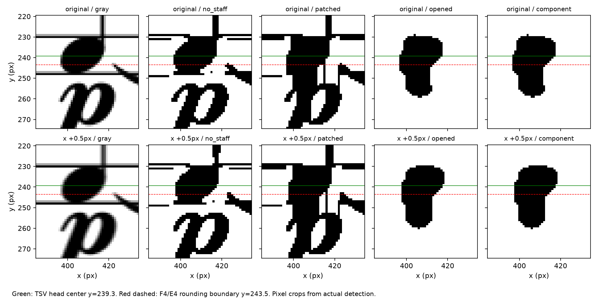

# 수평 0.5px 이동 뒤 첫 음고 오류 — 원인 추적

2026-10-06. main70bbab3에서 조사. 실제 exe 실패의 선행 기록은 ../beta_recheck_20261006/RECHECK.md와 PR #288. 이번 변경은 개발용 tools/check_header_symbols.py와 측정 기록뿐이다. 제품 함수·문턱·골든·selftest 기준은 바꾸지 않았다.

## 최초 오차와 원인

원본 Beethoven Op.18 no.1 Bravura 첫 음의 TSV는 `(407.7,239.3)` F4다. 원본/수평0.5px 영상에서 실제 run_page를 호출하고, sys.settrace로 원본 함수의 지역변수·반환값을 읽었다. 추적 전후 전체 JSON·PNG 바이트가 앞선 비추적 실행과 같아 관측으로 출력이 달라지지 않았음을 확인했다. 최초 광범위 추적은 느려 자체 진단 프로세스만 중단한 뒤 관련 네 함수로 좁혀 완료했다. 미완료 추적을 통과로 세지 않았다.

| 첫 보표 첫 음 | 원본 | x0.5px |
|---|---:|---:|
| TSV의 실제 머리 중심 y |239.3|239.3(수평 변환)|
| opening 성분 bbox 절대 y |229~259|230~260|
| 성분 높이 |31px|31px|
| opening 성분 중심 y |242.584|243.166|
| `_refine_y` 반환 절대 y |243.0|243.5|
| Notehead로 반환한 y |243|244|
| `grid_bottom`, spacing |248,18|248,18|
| 음고 raw_steps |0.55556|0.44444|
| 최종 음고/계이름 |F4/파|E4/미|

**시작 원인은 음표 아래의 셈여림 `p` 윗부분을 같은 머리 성분으로 붙인 것이다.** 원본과 오선 제거 영상에서는 음표 머리와 p가 떨어져 있다. 7px 세로 closing 뒤 둘이 이어지고, 11×9 타원 opening 뒤에도 p 윗부분이 연결된 채 남는다. 31px짜리 성분이 `_refine_y`로 들어가고, 밀도가 높은 행 구간이 p까지 포함돼 중심이 내려간다. 그 뒤 정수 좌표 반올림과 음고 스냅 경계가 최종 F4/E4를 가른다. 조표·음자리표·격자는 그대로이며 임시표나 렌더링 단계에서 바뀐 것이 아니다.

stages.png는 **실제 검출 함수 안**의 gray/오선제거/patched/opened/해당성분 부분 배열로 그렸다. morphology를 사본에서 다시 구현한 근거가 아니다. 초록선은 TSV 중심239.3, 빨간 점선은 음고 경계243.5다. 두 roi.npz는 동일 부분 배열을 보존한다. 전체 악보를 포함하지 않는다. component-join.json은 해당 부분 배열에서 실제 머리 점(406,239)과 p 점(408,256)의 연결성분도 대조한다. 두 입력 모두 오선 제거 뒤 서로 다른 성분, closing 뒤 같은 성분, opening 뒤도 같은 성분이다.



## 원인 대조

사본 원본에서 p 부분 사각형 `(392,251)~(425,300)`만 흰색으로 지운 뒤 원본/수평0.5px를 각각 현재 run_page로 처리했다. 첫 음은 두 경우 모두 y239·F4/파·certain으로 돌아왔다. 둘째 보표 첫 F4도 유지됐다. 이 사각형은 이 한 입력의 비음표 글리프를 제거하는 **진단용 대조**이며, 제품에 넣을 위치 필터나 음표/기호 판정 규칙이 아니다. 다른 음표/악보의 안전성 검증이나 채택안으로 확대하지 않는다.

counterfactual.json/log와 trace JSON에 값이 있다. 실제 run_page의 보강 검출에도 첫 음 y240·F4 후보가 있지만 최종 결과는 원래 검출을 유지한다. 그 존재만으로 올바른 후보를 일반적으로 고를 수 있다는 근거는 아니다.

## 재현·점검 도구 보완

기존 점검 도구는 원본 고정 입력만 처리했다. 보완 전 --shift-x 0.5는 종료2(인자 미지원)였다. 이제 실제 INTER_LINEAR·흰 테두리의 수평 재표본화를 거친 입력으로 **최종 pitch와 계이름**을 검사한다. 틀린 음고 후보도 report.json의 first_candidates에 남긴다. 생성한0.5px PNG SHA는 기존 실제 exe 실패 입력 SHA와 같다.

```powershell
python tools/check_header_symbols.py --check --output-dir output/phase-check-original
python tools/check_header_symbols.py --shift-x 0.25 --check --output-dir output/phase-check-025
python tools/check_header_symbols.py --shift-x 0.5 --check --output-dir output/phase-check-05
```

실측: 원본/0.25는 종료0, 0.5는 **종료1·첫F4/파1/2**. 기호 유령은 세 경우 모두0. 잘못된 E4를 정답으로 바꾸거나 예상 실패로 숨기지 않는다. 일반 run_all과 별도의 원인 재현 점검이 실패하는 상태이며 **제품 해결 완료가 아니다**. --check를 빼면 기존처럼 측정 결과를 저장하고 끝낸다. 기존 원본 기본 실행의 제품 결과는 바뀌지 않는다.

## 남긴 것

- 실제 수정 대상은 Claude 소유 notehead_detect.py의 서로 다른 글리프가 연결되는 검출/중심 추정 경로다. 규약에 따라 수정 요청을 WORKLOG에 남겼다.
- closing/opening/밀도/스냅 문턱을 바꾸는 안은 제안·채택하지 않았다. 실수 좌표만 남기는 안도 중심이 이미243.5까지 치우친 원인을 없애지 못한다.
- 기존 부분화소 단위 검사는 머리 존재를 보며 최종 음고를 보지 않는다. 이번 도구로 최종 음고를 재현하지만, 제품 오류가 고쳐질 때 최종 F4/파 불변을 일반 회귀 검사에 추가해야 한다.
- 인식/판정 코드·정답·골든·기본 제품 PNG/JSON 변화0. 새 빌드/Actions/Defender 중복 실행 없음. 최신 exe GUI 직접클릭·스피커·다운로드 SmartScreen 미확인 유지.

최종 전체검사: run-all.log의 39/39·실패0·건너뜀0. 골든711·PDF17쪽 스냅샷·기존 #52 유지. 일반 전체검사 녹색과 별도 .5 최종음고 재현 실패(종료1)를 함께 기록한다. 제품 오류가 고쳐졌다는 결론이 아니다.
